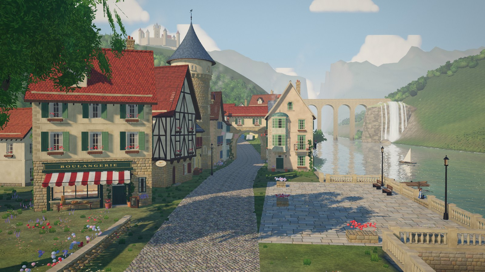

# 风眠镇 Windvale

一座依山傍水的 3D 江畔小镇，**全部由代码实时生成**：没有任何预制模型、贴图或图片素材。
几何体、石墙/屋瓦/石板路/树叶/云朵等纹理、江水与瀑布着色器，都在浏览器里现场算出来。

在线地址：<https://sunxiaoxi2039-star.github.io/windvale/>



## 怎么看

| 操作 | 方式 |
| --- | --- |
| 旋转视角 | 鼠标左键拖动（触屏：单指拖动） |
| 缩放 | 滚轮（触屏：双指捏合） |
| 平移 | 右键拖动（触屏：双指拖动） |
| 恢复默认视角 | 右下角「默认视角」或按 `R` |
| 电影漫游 | 「漫游」或按 `T`：缓慢经过面包店、江边女孩、绿玻璃小楼、圆塔、铁路桥与瀑布 |
| 纯净画面 | 「纯净画面」或按 `H`，隐藏所有界面 |
| 全屏 | 「全屏」或按 `F` |

`index.html` 是独立单文件，可以直接双击打开（需要联网从 jsDelivr 加载 Three.js r170）。
加载时会先生成纹理与几何体，普通电脑约几秒钟。

## 画面里有什么

- **左侧生活街区**：红白条纹布艺遮阳棚的面包店（可透过橱窗看到店内面包架）、BOULANGERIE 招牌与会随风轻摆的吊牌、面包篮、小黑板、窗台花箱、门边攀援的玫瑰与常春藤；一棵大树在左上角框景，树影斑驳地落在石板路上。
- **中央特色建筑**：曲线锥顶的石砌圆塔（顶上有风向标）、半木结构挑檐小楼、黄墙石板瓦小楼与花架、跨街的石拱门和拱上小屋、拱门前横过街道的晾衣绳。
- **右侧江边**：带双层绿玻璃凸窗和铁艺阳台的特色住宅、石栏杆临水露台、坐在矮墙上的女孩和她身边的黑白小猫（手绘风格）、木码头与几艘小船、江心一艘小帆船。
- **远景**：森林山坡、山顶城堡、跨越峡谷的石拱铁路桥、从岩崖倾泻进江里的瀑布和水雾、远山与云。

## 动态（克制、各自不同步）

江水（自定义 GLSL：多层流动波纹、平面实时倒影、岸边与码头木桩/船边的局部涟漪、下游尾迹）、
树叶花草摇曳、晾晒衣物摆动、烟囱炊烟、小船起伏、女孩会眨眼、转头看猫或看江、头发随风飘、小腿轻晃，黑猫会眨眼、转头、甩尾巴、动耳朵、
蝴蝶在花丛间、白鸥掠过江面、云缓慢移动、瀑布流动与水雾。

## 技术要点

- Three.js r170，WebGL2，ACES 色调映射 + sRGB 输出；EffectComposer：4×MSAA → 轻量 Bloom → 输出 → 自定义调色（冷暗部/暖高光、暗角、细颗粒）。
- 午后侧逆光的方向光 + 4096 PCF 软阴影；天空着色器生成的 PMREM 环境光作为柔和补光。
- 自定义空气透视：指数雾随高度变薄、随距离偏蓝，远山层次更柔和。
- 建筑用一套程序化"建筑套件"：带真实洞口和窗洞进深的墙体、带厚度和自然下垂弧度且逐排有台阶的瓦屋顶、百叶窗、窗台、花箱、隅石、檐口、老虎窗、烟囱等，按材质合批成少量 draw call。
- 女孩和小猫：我们自己的原创角色（米白 T 恤 + 藏青背带裙、深棕短发配黄色发夹、光脚；黑白小奶猫），**2D 手绘**放进 3D 小镇。
  - 正面按自己的参考图描出来：先把参考图按色块分区，沿边缘取控制点，再人工整理眼睛、五官、扣子、褶皱等细节；最终代码里只有曲线坐标（约 1100 个控制点），不含任何图片数据。
  - 画法像赛璐珞：每个色块平涂、不自带描边；墨线是一段段两头收尖、在转折处断开的笔触，被遮住的边不画线；阴影是单独画好的形状，不是平移出来的。
  - 侧面和正后方的头部、肩膀按三视图描出来；坐着的身体、腿和脚按它补画；另加一张手画的背面 3/4，覆盖小镇最常见的镜头角度。
  - 五张关键角度（正面、左右侧面、背面 3/4、正后方）覆盖一整圈，3D 姿势骨架让画面随镜头角度弯折，再交给下一张；会眨眼、小幅转头、头发飘、小腿轻晃；小猫会眨眼、转头、甩尾、动耳朵。
  - 每帧重画到小画布，贴在面向镜头的卡片上；腿单独一张卡片放在真实深度，从身后看会被矮墙挡住；套用同样的空气透视雾，坐处有柔和的接触阴影。
- 树：锥度枝干管 + 体积法线的叶片卡片（叶片透光）；远处森林用实例化卡片树，按扇区分组做视锥剔除；花草、栏杆瓶柱、草丛全部 Instancing。
- 地形用极坐标网格（近处密、远处疏），陡坡用三平面投影的岩石纹理。
- 自适应分辨率：帧时过长自动降低像素比，宽松时再升回去；竖屏自动加大视场角并换用更近的默认机位。
- 手机档（触屏或小屏自动启用）：森林、花草实例约减半，地形网格更疏，阴影贴图 2048，关闭 Bloom，2× MSAA，石板路纹理半分辨率。

## 加载速度

所有纹理和几何体都在打开页面时现算，所以加载时间主要花在 CPU 上。优化后（按约 4 倍降速模拟手机 CPU 测量）：

| 阶段 | 优化前 | 优化后 |
| --- | --- | --- |
| 程序化纹理 | 14.6 s | 2.9 s |
| 小镇建筑合批 | 2.9 s | 1.9 s |
| 地形 | 2.5 s | 0.6 s |
| JS 生成总计 | 约 27 s | 约 9 s |

做法：fBm 噪声先烘焙到小网格再双线性采样；去掉逐块的 canvas 模糊滤镜，改为整张一次；石板路 Voronoi 少查邻格；合批直接写平坦数组、重复的方块/圆柱几何体缓存；Three.js 改用压缩版；场景搭到一半就开始预编译着色器。

在浏览器控制台运行 `window.__prof` 可以看到各阶段耗时。

## 文件结构

```
windvale/
  index.html      构建产物：可直接打开的单文件
  cover.jpg       默认视角截图（也用作分享卡片图）
  build.py        把 src/ 拼成 index.html
  src/
    head.html       页面骨架、样式、界面、import map
    00-core.js      随机数、噪声、几何工具、合批 Batch
    01-textures.js  全部程序化 canvas 纹理
    02-materials.js 材质与着色器补丁（风、叶片透光、空气透视、三平面岩石）
    03-world.js     河道、地形、街道、码头、露台、栏杆
    04-kit.js       建筑套件（墙、窗、门、屋顶、烟囱……）
    05-buildings.js 面包店、圆塔、拱门、绿玻璃小楼等每栋建筑
    06-water-sky.js 天空、云、江水着色器与平面倒影
    07-nature.js    树、森林、花草、常春藤、城堡、铁路桥、瀑布
    08-life.js      船、蝴蝶、白鸥、炊烟、晾衣、粒子
    08b-characters.js 女孩与小猫：描线/赛璐珞绘制、姿势骨架、正面与背面关键角度、眨眼转头等动画、镜头朝向卡片
    09-main.js      渲染器、灯光、后期、交互、漫游、主循环
```

修改 `src/` 后运行：

```bash
python3 windvale/build.py
```

调试参数：`?still` 冻结时间（截图用），`?clean` 启动时隐藏界面，`?cam=x,y,z,tx,ty,tz` 指定相机，`?q=low|high` 强制画质档，`?sm=2048` 指定阴影贴图尺寸，`?msaa=0|2|4` 指定多重采样，`?film` 启用逐帧导出接口 `window.__renderFrame`（录制短片用）。

## 已知限制

- 需要支持 WebGL2 的浏览器；集成显卡上会自动降分辨率以保持流畅。
- 依赖 jsDelivr CDN 加载 Three.js，完全离线时无法打开。
- 截图是在无 GPU 的软件渲染（SwiftShader）环境里生成的，真实显卡上的画面一致但会更流畅。
